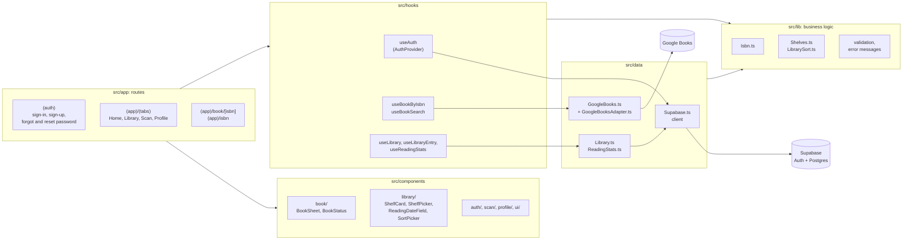

# ScannBook

**Scan a book, put it on your shelf, track your reading.**


ScannBook is a mobile app (iOS and Android) that identifies a book from its barcode, shows its details from Google Books, and puts it on a reading shelf. Every reader has an account and finds their shelves in their own space, on any phone.

## Context

A course project built in one week, from November 24 to 27, 2026, with a final presentation on Friday. It is graded as much on the product as on the way we work: branches, Conventional Commits, pull requests, reviews and ADRs.

**The MVP in one sentence:** I create my account, scan a book, see its details, add it to a shelf, and find my library filtered by shelf when I sign back in.

## Features

Five shelves: **Wishlist**, **To read**, **Reading**, **Read**, **Abandoned** (labelled _Wishlist_, _À lire_, _En cours_, _Lu_, _Abandonné_ in the app, whose UI is in French). A book is always on exactly one shelf, and moving it to another shelf updates its reading dates automatically.

| Priority         | Features                                                                                                                                                |
| ---------------- | ------------------------------------------------------------------------------------------------------------------------------------------------------- |
| **Must** (MVP)   | Sign up, sign in, sign out · ISBN scan · manual ISBN entry · book details · add to a shelf · library filtered by shelf · move to another shelf · remove |
| **Should**       | Search by title or author · start and finish dates · page progress                                                                                      |
| **Could**        | Password reset · sorting · statistics                                                                                                                   |
| **Out of scope** | Google/Apple sign-in · offline mode · sharing · ratings and reviews                                                                                     |

> Screenshots will be added to `docs/screenshots/` as features ship.

## Stack

| Need                 | Choice                                                             | ADR                                                           |
| -------------------- | ------------------------------------------------------------------ | ------------------------------------------------------------- |
| Platform             | React Native (iOS + Android, a single codebase)                    | [0001](docs/adr/0001-adopt-react-native.md)                   |
| Framework            | Expo SDK 58, tested on a phone with Expo Go                        | [0001](docs/adr/0001-adopt-react-native.md)                   |
| Navigation           | Expo Router: `(auth)` / `(app)` groups, tabs + Stack               | -                                                             |
| Guest access         | App open without an account, the library needs one                 | [0007](docs/adr/0007-open-the-app-without-an-account.md)      |
| Tab bar              | Our own bar on the headless tabs of `expo-router/ui`               | [0008](docs/adr/0008-custom-tab-bar.md)                       |
| Language             | Strict TypeScript                                                  | [0001](docs/adr/0001-adopt-react-native.md)                   |
| Accounts and storage | Supabase: email/password Auth + Postgres with Row Level Security   | [0003](docs/adr/0003-library-supabase.md)                     |
| Book data            | Google Books API v1 (`fetch` + adapter)                            | [0002](docs/adr/0002-use-google-books-as-book-data-source.md) |
| Scanning             | `expo-camera` (`CameraView` + `barcodeScannerSettings`)            | -                                                             |
| Password reset       | 6-digit email code, sent through custom SMTP (project Gmail)       | [0004](docs/adr/0004-password-reset-with-email-code.md)       |
| Reading dates        | Set when a book changes shelf, editable on the book page           | [0005](docs/adr/0005-reading-dates-follow-the-shelf.md)       |
| Date picker          | `@expo/ui/community/datetime-picker` (included in Expo Go)         | -                                                             |
| Book search          | One Google Books request, local relevance scoring, in-memory cache | [0006](docs/adr/0006-search-relevance-scoring.md)             |

All recorded decisions are listed in [docs/adr/](docs/adr/).

## Getting started

### Prerequisites

- [Node.js](https://nodejs.org/) LTS
- [pnpm](https://pnpm.io/installation): `npm install -g pnpm`
- The [Expo Go](https://expo.dev/go) app on your phone
- A [Supabase](https://supabase.com/) project, with _Confirm email_ turned off in the _Authentication_ settings (Email provider)
- A [Google Books API](https://console.cloud.google.com/apis/library/books.googleapis.com) key

### Installation

```bash
git clone https://github.com/AlexandreRichert/ScannBook.git
cd ScannBook
pnpm install
```

### Environment variables

```bash
cp .env.example .env
```

Then fill in the three variables in `.env`:

| Variable                           | Where to find it                                               |
| ---------------------------------- | -------------------------------------------------------------- |
| `EXPO_PUBLIC_GOOGLE_BOOKS_API_KEY` | Google Cloud Console → Credentials                             |
| `EXPO_PUBLIC_SUPABASE_URL`         | Supabase → Project Settings → API                              |
| `EXPO_PUBLIC_SUPABASE_ANON_KEY`    | Supabase → Project Settings → API (_anon_ / _publishable_ key) |

`.env` is ignored by Git. Only `.env.example`, with empty values, is committed.

### Database

The schema (`books` table, constraints and RLS policies) is versioned in [`supabase/schema.sql`](supabase/schema.sql). To create it, run that file in the **SQL Editor** of your Supabase project.

### Run the app

```bash
pnpm start
```

Scan the QR code with Expo Go (Android) or the Camera app (iOS).

| Script                      | Purpose                                              |
| --------------------------- | ---------------------------------------------------- |
| `pnpm start`                | Start the Expo development server                    |
| `pnpm android` / `pnpm ios` | Open the app on an Android emulator or iOS simulator |
| `pnpm web`                  | Open the web version                                 |
| `pnpm lint`                 | Lint (ESLint via `expo lint`)                        |
| `pnpm typecheck`            | Type checking (`tsc --noEmit`)                       |

## Keys and security

Variables prefixed with `EXPO_PUBLIC_` are **embedded in the app bundle**: anyone can extract them. They are therefore not secret, by design:

- **The Google Books key** is restricted to the Books API only, with a capped quota in the Google Cloud Console.
- **The Supabase _anon_ key** is meant to be public. Data is protected by **Row Level Security**: every row in `books` carries its owner's `user_id`, and Postgres rejects any read or write from another account. The app itself never filters by user.
- **The Supabase `service_role` key** is never used in the app.

## Architecture

Dependencies flow in one direction only, from routes to data. Each external service sits behind a single file in `src/data/`, and `src/lib/` holds the business logic (ISBN checks, shelf and date rules, sorting, validation, error messages) without ever calling a service.



Project structure:

```text
src/
  app/                      # Expo Router routes
    _layout.tsx             # AuthProvider + guards based on the session
    (auth)/                 # sign-in, sign-up, forgot-password, reset-password
    (app)/
      _layout.tsx           # Stack above the tabs
      (tabs)/               # index (Home), library, scan, profile
      book/[isbn].tsx       # book details, shelf, progress and reading dates
      isbn.tsx              # manual ISBN entry (modal)
  components/
    auth/                   # AuthForm
    book/                   # BookSheet, BookSheetSkeleton, BookStatus
    library/                # ShelfCard, ShelfPicker, LibraryBookRow, ReadingDateField, SortPicker
    profile/                # ReadingStatsCard
    scan/                   # ScanOverlay, ScanUnavailable
    ui/                     # Button, TextField
  constants/                # theme and screen colors
  data/                     # Supabase.ts, GoogleBooks.ts + adapter, Library.ts, ReadingStats.ts
  hooks/                    # useAuth, useBookByIsbn, useBookSearch, useLibrary, useLibraryEntry, ...
  lib/                      # Isbn.ts, Shelves.ts, LibrarySort.ts, validation and error messages
  types/                    # Book.ts (shared contract)
supabase/
  schema.sql                # books table, constraints and RLS policies
```

## Contributing

GitHub Flow: one short-lived branch per issue (`feat/12-barcode-scanner`), Conventional Commits, a reviewed PR for every change, squash merge, then the branch is deleted. Full details in [CONTRIBUTING.md](CONTRIBUTING.md).

## Decisions

Architecture decisions are recorded as ADRs in [docs/adr/](docs/adr/).

## Team

| Member     | Role                       | GitHub                                                   |
| ---------- | -------------------------- | -------------------------------------------------------- |
| Alexandre  | Development, documentation | [@AlexandreRichert](https://github.com/AlexandreRichert) |
| Louna      | Development, documentation | [@Wysath](https://github.com/Wysath)                     |
